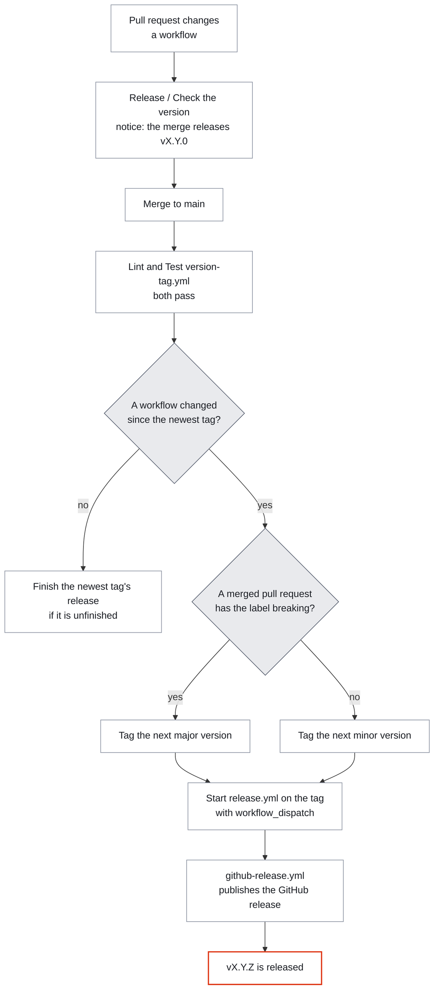

<div align="center">


# github-reusable-workflows

### One place for the CI/CD steps my repositories share.

**Eight reusable GitHub Actions workflows:** build and deploy a Vite site, build and test a Python
package, lint workflows and prove their action pins, check security alerts, and make the merge to
`main` the release. Callers pin a full commit SHA, and every input, output and permission below is
read from the workflow files.

<br>

[](https://github.com/agusgonzaleznic/github-reusable-workflows/releases)
[](https://github.com/agusgonzaleznic/github-reusable-workflows/actions/workflows/lint.yml)
<br>
[](https://docs.github.com/en/actions/how-tos/reuse-automations/reuse-workflows)
[](#-security)

<br>

**[Quick start](#-quick-start) · [Workflows](#-the-workflows) · [Releases](#-how-a-release-happens) · [Security](#-security) · [Troubleshooting](#-troubleshooting) · [Contributing](#-contributing) · [Support](#-support-this-project)**

</div>

---

## 🧭 What this is

Each file under `.github/workflows/` with `workflow_call` as its trigger is a reusable workflow.
A repository calls one with a short job and keeps nothing else of it. As of 14 November 2026 there
are eight, and the latest release is v1.9.0. Two more files here, `lint.yml` and `release.yml`, are
this repository's own gate and release, and they call the shared ones.

What it doesn't do:

- **No upload to PyPI.** Trusted Publishing only trusts a job in the workflow file registered on PyPI,
  so the caller keeps one short publish job (see [Python Build](#python-build)).
- **The Vite cache is npm only.** The two Vite workflows always set up Node with `cache: 'npm'`. The
  install, lint and build commands are inputs.
- **No test of the Vite, Python and alert workflows until someone calls them.** What runs on every
  pull request here is actionlint, the action-pin check and the scenarios of `version-tag.yml`, and
  `github-release.yml` runs on every release.
- **No licence file yet** (see [Licence](#licence)).

## ⚡ Quick start

Call a workflow from a job, pinned to a full commit SHA with the release in a comment:

```yaml
name: CI

on:
  pull_request:
    branches: [main]

jobs:
  ci:
    uses: agusgonzaleznic/github-reusable-workflows/.github/workflows/vite-ci.yml@1832ea3171529c36e663d34965917c9f14694ce5  # v1.9.0
```

Every example below pins v1.9.0, the latest release as of 14 November 2026. Resolve the SHA of the
release you want with:

```bash
gh api repos/agusgonzaleznic/github-reusable-workflows/commits/v1.9.0 --jq .sha
```

A caller names a check `<calling job name> / <job name>`, so the job names below are part of the
contract, and a ruleset can require them.

| Workflow | What it does | The caller grants | Its checks |
|---|---|---|---|
| [`vite-build-deploy.yml`](#vite-build-and-deploy) | Builds a Vite app and deploys it to GitHub Pages | `contents: read`, `pages: write`, `id-token: write` | `Build`, `Deploy` |
| [`vite-ci.yml`](#vite-ci) | Lints and builds a Vite app on pull requests | `contents: read` | `Lint and Build` |
| [`python-build.yml`](#python-build) | Builds the sdist and wheel with uv, uploads them as one artifact | `contents: read` | `Build sdist and wheel` |
| [`actions-lint.yml`](#lint-workflows-and-action-pins) | actionlint plus a proof of every action pin | `contents: read` | `actionlint`, `Verify action pins` |
| [`python-tests.yml`](#python-tests) | Runs the tests once per Python version, from hash-locked requirements | `contents: read` | `Python 3.12`, `Python 3.13` (one per version) |
| [`security-alerts.yml`](#security-alerts) | Lists open alerts of every repository an account owns, fails on any | nothing | `Open security alerts` |
| [`github-release.yml`](#github-release) | Publishes the GitHub release of a version tag, from the trunk only | `contents: write` | `Publish the release` |
| [`version-tag.yml`](#version-tag) | Makes the merge to the default branch the release | see [Version Tag](#version-tag) | `Check the version`, `Tag the version` |

## 📦 The workflows

### Vite Build and Deploy

`vite-build-deploy.yml` builds a Vite application and deploys it to GitHub Pages.

```yaml
name: Deploy to GitHub Pages

on:
  push:
    branches: [main]
  workflow_dispatch:

# The caller grants at least the permissions the jobs declare, and owns the concurrency group.
permissions:
  contents: read
  pages: write
  id-token: write

concurrency:
  group: "pages"
  cancel-in-progress: false

jobs:
  build-and-deploy:
    uses: agusgonzaleznic/github-reusable-workflows/.github/workflows/vite-build-deploy.yml@1832ea3171529c36e663d34965917c9f14694ce5  # v1.9.0
    permissions:
      contents: read
      pages: write
      id-token: write
    with:
      node-version: '22'              # Optional, default: '22'
      install-command: 'npm ci'       # Optional, default: 'npm ci'
      lint-command: 'npm run lint'    # Optional, default: 'npm run lint'
      build-command: 'npm run build'  # Optional, default: 'npm run build'
      artifact-path: 'dist'           # Optional, default: 'dist'
      run-lint: true                  # Optional, default: true
    secrets:
      build-env-vars: ${{ secrets.BUILD_ENV_VARS }}  # Optional, KEY=value lines
```

| Input | Description | Required | Default |
|---|---|---|---|
| `node-version` | Node.js version to use | No | `'22'` |
| `install-command` | Command to install dependencies | No | `'npm ci'` |
| `lint-command` | Command to lint the project | No | `'npm run lint'` |
| `build-command` | Command to build the project | No | `'npm run build'` |
| `artifact-path` | Path to the build output directory (relative path without `./`) | No | `'dist'` |
| `run-lint` | Whether to run linting | No | `true` |
| `build-env-vars` (secret) | Environment variables to set during the build, one `KEY=value` per line | No | |

The `build` job fails when `index.html` isn't in the artifact path. `build-env-vars` is appended to
`$GITHUB_ENV` as written, so every later step sees it, dependency build code included. Before that,
the workflow masks each value of 8 characters or more (empty lines, `#` lines and `KEY=` lines get no
mask). Don't put comments in the secret: the runner rejects a line without `=`. A shorter value isn't
masked, so don't print it.

**The repository must deploy from GitHub Actions.** Under **Settings**, **Pages**, **Build and
deployment**, set **Source** to **GitHub Actions**. With **Deploy from a branch**, GitHub builds the
branch with Jekyll and ignores the artifact: the workflow looks green and the site is wrong.

### Vite CI

`vite-ci.yml` lints and builds a Vite application, for pull requests.

```yaml
name: CI

on:
  pull_request:
    branches: [main]
  workflow_dispatch:

jobs:
  ci:
    uses: agusgonzaleznic/github-reusable-workflows/.github/workflows/vite-ci.yml@1832ea3171529c36e663d34965917c9f14694ce5  # v1.9.0
    with:
      node-version: '22'              # Optional, default: '22'
      install-command: 'npm ci'       # Optional, default: 'npm ci'
      lint-command: 'npm run lint'    # Optional, default: 'npm run lint'
      build-command: 'npm run build'  # Optional, default: 'npm run build'
      artifact-path: 'dist'           # Optional, default: 'dist'
      verify-build-output: true       # Optional, default: true
```

| Input | Description | Required | Default |
|---|---|---|---|
| `node-version` | Node.js version to use | No | `'22'` |
| `install-command` | Command to install dependencies | No | `'npm ci'` |
| `lint-command` | Command to lint the project | No | `'npm run lint'` |
| `build-command` | Command to build the project | No | `'npm run build'` |
| `artifact-path` | Path to the build output directory | No | `'dist'` |
| `verify-build-output` | Whether to verify build output exists | No | `true` |

With `verify-build-output`, the job fails unless `artifact-path` is a directory that holds `index.html`.

### Python Build

`python-build.yml` builds the sdist and wheel of a Python project with uv and uploads them as one
artifact, ready for a publish job in the calling workflow. On a tag it fails when the built version
differs from the tag (`v1.2.3` or `1.2.3`). The artifact is kept for 7 days.

The upload to PyPI can't live here. PyPI's Trusted Publishing only trusts a job defined in the
workflow file registered on PyPI, and a job from another repository's reusable workflow never matches
it ([pypi/warehouse#11096](https://github.com/pypi/warehouse/issues/11096), open as of 14 November
2026). So the caller keeps one short publish job, and no PyPI token is involved.

Put the build and the publish in the workflow that runs on the version tag (`release.yml` here), so
PyPI registers one file name. The same `build` job can feed
[GitHub Release](#github-release), which attaches its files to the release:

```yaml
name: Release

on:
  push:
    tags:
      - 'v[0-9]+.[0-9]+.[0-9]+'
  workflow_dispatch:  # how version-tag.yml starts it on the tag it made

permissions: {}

concurrency:
  group: release
  cancel-in-progress: false

jobs:
  build:
    uses: agusgonzaleznic/github-reusable-workflows/.github/workflows/python-build.yml@1832ea3171529c36e663d34965917c9f14694ce5  # v1.9.0
    permissions:
      contents: read
    with:
      build-constraints: requirements/build.txt  # Optional, default: '' (no lock)

  publish:
    needs: build
    runs-on: ubuntu-latest
    environment:
      name: pypi
      url: https://pypi.org/project/<name>/${{ needs.build.outputs.version }}/
    permissions:
      id-token: write  # Trusted Publishing, nothing else
    steps:
      - uses: actions/download-artifact@9000827ccba6bdab643e8b6fd33ac0654aef8333  # v8.0.2
        with:
          name: python-dist
          path: dist/
      - uses: pypa/gh-action-pypi-publish@7245906fb61fa33a13554f9d5fb856fe61758086  # v1.14.3
```

| Input | Description | Required | Default |
|---|---|---|---|
| `python-version` | Python version uv builds with | No | `'3.13'` |
| `uv-version` | uv version to install (setup-uv verifies its checksum) | No | `'0.13.4'` |
| `build-constraints` | Hash-locked constraints file for the build backend, relative to the repo root | No | `''` |
| `artifact-name` | Name of the artifact that holds `dist/` | No | `'python-dist'` |

**Outputs.** `version`, the version that was built.

On PyPI, the project's Publishing settings need a GitHub publisher with the owner, the repository, the
caller's workflow file name (`release.yml` above, never `python-build.yml`) and the environment
(`pypi`). On GitHub, an environment of that name limited to `v*` tags keeps any other ref from
publishing.

`uv build` fetches the project's build backend (hatchling, say) from PyPI at build time. A constraints
file compiled with hashes pins it. `build.in` lists the project's `[build-system] requires`. Compile it
for the oldest Python the project supports, and leave out releases younger than a week:

```bash
uv pip compile requirements/build.in --universal --generate-hashes --python-version 3.12 \
  --exclude-newer <the date a week ago> -o requirements/build.txt
```

The `uv-version` and `python-version` defaults change only by hand here. Dependabot doesn't see them.

### Lint Workflows and Action Pins

`actions-lint.yml` lints the caller's workflows with actionlint 1.7.12 (the linux amd64 build,
checksum-verified) and proves every action pin: a full commit SHA, a `# vX.Y.Z` comment, and that tag
resolving to exactly that commit upstream. A pattern or path that matches nothing fails, so a typo can't
pass. This repository's own `lint.yml` calls it too.

```yaml
name: Lint

on:
  pull_request:
  push:
    branches: [main]

permissions:
  contents: read

concurrency:
  group: ${{ github.workflow }}-${{ github.ref }}
  cancel-in-progress: true

jobs:
  lint:
    name: Lint  # its checks: "Lint / actionlint", "Lint / Verify action pins"
    uses: agusgonzaleznic/github-reusable-workflows/.github/workflows/actions-lint.yml@1832ea3171529c36e663d34965917c9f14694ce5  # v1.9.0
    with:
      pin-paths: .github/workflows action.yml  # Optional, default: .github/workflows
```

| Input | Description | Required | Default |
|---|---|---|---|
| `actionlint-files` | Space-separated files or globs for actionlint; each must match a file | No | `'.github/workflows/*.yml'` |
| `pin-paths` | Space-separated files or folders whose pins are verified; each must exist | No | `'.github/workflows'` |
| `prepare-command` | Shell command run before actionlint, for example rendering workflow templates | No | `''` |
| `extra-pin-command` | Shell command run after the pin check, with `GH_TOKEN` set | No | `''` |
| `runs-on` | Runner label for both jobs; a Linux x64 runner, since actionlint is the linux amd64 build | No | `'ubuntu-latest'` |

### Python Tests

`python-tests.yml` runs a Python project's tests once per Python version, in a fresh venv that installs
only hash-locked requirements (`pip install --require-hashes --no-deps --only-binary :all:`). A
project that needs only the standard library sets `install-requirements: false`, and the venv stays
empty.

```yaml
jobs:
  tests:
    name: Tests  # its checks: "Tests / Python 3.12", "Tests / Python 3.13"
    uses: agusgonzaleznic/github-reusable-workflows/.github/workflows/python-tests.yml@1832ea3171529c36e663d34965917c9f14694ce5  # v1.9.0
    with:
      requirements: requirements/lock.txt requirements/test.txt
      apt-packages: ghostscript  # Optional
      pythonpath: src            # Optional
```

| Input | Description | Required | Default |
|---|---|---|---|
| `python-versions` | JSON list of Python versions, one job each | No | `'["3.12", "3.13"]'` |
| `requirements` | Space-separated hash-locked requirement files | No | `'requirements.txt'` |
| `install-requirements` | `false` installs nothing and ignores `requirements`, for a project that needs only the standard library | No | `true` |
| `apt-packages` | Space-separated apt packages the tests need | No | `''` |
| `pythonpath` | `PYTHONPATH` for the test command | No | `''` |
| `test-command` | Command that runs the tests | No | `'.venv/bin/python -m pytest -q'` |
| `runs-on` | Runner label | No | `'ubuntu-latest'` |

A ruleset requires, for example, `Tests / Python 3.12`.

### Security Alerts

`security-alerts.yml` lists the open Dependabot, code scanning and secret scanning alerts of every
repository an account owns, and fails the run when any alert is open or when any answer can't be
trusted. Alerts created in the last 8 days are marked NEW, and archived repositories are skipped. Call
it from a **private** repository: the run summary names repositories, packages and alert links, and
anyone can read a public repository's runs.

It fails closed. Only three answers that mean "this scanner doesn't exist here" are accepted besides a
200: code scanning on a private Free-plan repository, secret scanning there, and a repository CodeQL
has nothing to analyse in. So an expired, revoked or under-scoped token turns the run red instead of
reading as no alerts. So does a token that sees fewer than `min-repos` repositories, and an alert kind
no repository answered for. A run with `control: true` reads closed alerts instead and must fail, which
proves the check can.

```yaml
name: Security alerts

on:
  schedule:
    - cron: "17 6 * * 1"  # Mondays 06:17 UTC
  workflow_dispatch:
    inputs:
      control:
        description: 'Read closed alerts instead of open ones; the run must fail'
        type: boolean
        default: false

permissions: {}

jobs:
  alerts:
    name: Alerts
    uses: agusgonzaleznic/github-reusable-workflows/.github/workflows/security-alerts.yml@1832ea3171529c36e663d34965917c9f14694ce5  # v1.9.0
    with:
      owner: agusgonzaleznic
      min-repos: 16
      control: ${{ inputs.control || false }}
    secrets:
      alerts-token: ${{ secrets.SECURITY_ALERTS_TOKEN }}
```

| Name | Description | Required | Default |
|---|---|---|---|
| `owner` | Account whose repositories are checked | Yes | |
| `min-repos` | Fewest repositories the token must see; raise it when one is created (a number) | Yes | |
| `control` | Read closed alerts instead of open ones; the run must fail | No | `false` |
| `runs-on` | Runner label | No | `'ubuntu-latest'` |
| `alerts-token` (secret) | Fine-grained token, read-only: Dependabot alerts, Code scanning alerts, Secret scanning alerts and Metadata, on all repositories | Yes | |

Pass the token as a named secret, never `secrets: inherit`. GitHub sends a failed scheduled run's
notification to the account that created the workflow, or to the last one that changed its cron line,
so only the owner's account should edit it.

### GitHub Release

`github-release.yml` publishes the GitHub release of the version tag the calling workflow runs on, from
the trunk only. It fails on anything but a tag `vX.Y.Z`, on a tag that no longer names the commit the
run started from, and on a tag whose commit isn't on the default branch. With
[Version Tag](#version-tag) the merge makes the tag and starts the release on it, so nobody pushes a
tag by hand. The notes are generated from the pull requests merged since the previous release. With
`artifact-name` set, the files of that artifact are attached with a `SHA256SUMS` file for them. gh
keeps the release a draft until every file is uploaded and deletes the draft when an upload fails.

```yaml
name: Release

on:
  push:
    tags:
      - 'v[0-9]+.[0-9]+.[0-9]+'
  workflow_dispatch:  # how version-tag.yml starts it on the tag it made

permissions: {}

concurrency:
  group: release
  cancel-in-progress: false

jobs:
  build:
    name: Package build
    uses: agusgonzaleznic/github-reusable-workflows/.github/workflows/python-build.yml@1832ea3171529c36e663d34965917c9f14694ce5  # v1.9.0
    permissions:
      contents: read

  release:
    name: Release  # its check: "Release / Publish the release"
    needs: build
    uses: agusgonzaleznic/github-reusable-workflows/.github/workflows/github-release.yml@1832ea3171529c36e663d34965917c9f14694ce5  # v1.9.0
    permissions:
      contents: write  # creates the release and uploads its files, nothing else
    with:
      artifact-name: python-dist  # Optional, default: '' (attaches nothing)
```

| Input | Description | Required | Default |
|---|---|---|---|
| `artifact-name` | Artifact whose files are attached, with a `SHA256SUMS` file; empty attaches nothing | No | `''` |
| `runs-on` | Runner label | No | `'ubuntu-latest'` |

**Outputs.** `url`, the URL of the published release.

To check a download, run `sha256sum -c SHA256SUMS` in the folder that holds the files
(`shasum -a 256 -c SHA256SUMS` on macOS). This repository's own `release.yml` calls the workflow for
every version tag, from the tagged commit.

### Version Tag

`version-tag.yml` makes the merge to the default branch the release, so nobody pushes a tag or
publishes a release by hand. On a push to the default branch it tags the commit `vX.Y.Z` when
something that ships changed, starts the caller's release workflow on that tag, waits for it and fails
with it. On a pull request it says which version the merge releases and, with `version` set, fails a
change that ships under a version that is already out. The caller picks one of two ways to choose the
version:

| Input | For | On a pull request | On the default branch |
|---|---|---|---|
| `version`, from the code (`__version__`, say) | A package whose files carry their version | A change under `release-paths` needs a version newer than every `vX.Y.Z` tag | A newer version is tagged and released. A change under `release-paths` with the version unchanged fails the run, because it would never ship |
| `version-from-tags: true` | A repository whose tags are its only version | A notice of the version the merge releases | When anything under `release-paths` changed since the newest tag: the next minor version, or the next major version when a pull request merged since that tag has the label `breaking`; `1.0.0` when there is no tag |

An empty `version` without `version-from-tags` fails, and so do both together, so a typo in the caller
can't fall through to the other way.

Only the run of the default branch's current tip tags anything, so a re-run of an older commit passes
with a notice. A release is finished when a run of the release workflow on its tag succeeded (or, for
a tag that no run ever released, when the tag has a GitHub release). A run with nothing newer to
release finishes the newest tag's release: it waits for a release run that is still going, re-runs the
failed jobs of one that failed (the GitHub release may be out while an upload to PyPI failed), and
starts the release when the tag has neither a run nor a GitHub release. A newer version is tagged and
released at once and replaces an unfinished release, so the fix for a release that can't succeed can
always ship. Versions compare as numbers (`1.10.0` is newer than `1.9.0`). A tag without the `v`, such
as a `1.0.0` made by hand before the workflow, counts as a version and as released, and new tags always
get the `v`. Tags of any other shape, such as `v2` or `v3.0.0-rc1`, are ignored. A lookup that fails
stops the run rather than guess.

With the caller's concurrency group from the example below, a run on the default branch waits up to 50
minutes for its release run, and the next merge's run queues behind it. GitHub keeps one queued run per
concurrency group: a newer merge replaces the queued run, which then shows as cancelled, and the newer run releases
both changes. To retry a release, re-run the newest run on the default branch. A re-run of an older one
releases nothing and can replace the queued run of the tip.

The job tags with the caller's `GITHUB_TOKEN`, and GitHub starts no workflow for events that token
causes, except `workflow_dispatch` and `repository_dispatch` (and a few pull request events, which wait
for approval) ([GitHub's documentation](https://docs.github.com/en/actions/concepts/security/github_token)).
So the release workflow lists `workflow_dispatch` among its triggers, as in
[GitHub Release](#github-release): it runs with `github.ref` set to the tag, as for a pushed tag. A
tag ruleset that blocks updates and deletions of `v*` fits. Tag creation must stay open to the workflow.

```yaml
on:
  pull_request:
  push:
    branches: [main]

permissions:
  contents: read

# Runs on main never cancel a running one: it may be waiting for its release.
concurrency:
  group: ${{ github.workflow }}-${{ github.ref }}
  cancel-in-progress: ${{ github.event_name == 'pull_request' }}

jobs:
  # tests and package jobs here; package has the output version

  check-version:
    name: Release  # its check: "Release / Check the version"
    if: github.event_name == 'pull_request'
    needs: package
    uses: agusgonzaleznic/github-reusable-workflows/.github/workflows/version-tag.yml@1832ea3171529c36e663d34965917c9f14694ce5  # v1.9.0
    permissions:
      contents: read
    with:
      version: ${{ needs.package.outputs.version }}  # or version-from-tags: true
      release-paths: |
        src/
        pyproject.toml

  release:
    name: Release  # its check: "Release / Tag the version"
    if: github.event_name == 'push'
    needs: [tests, package]
    uses: agusgonzaleznic/github-reusable-workflows/.github/workflows/version-tag.yml@1832ea3171529c36e663d34965917c9f14694ce5  # v1.9.0
    permissions:
      contents: write  # the tag
      actions: write   # starts release.yml on it, watches the run and re-runs its failed jobs
    with:
      version: ${{ needs.package.outputs.version }}
      release-paths: |
        src/
        pyproject.toml
```

With `version-from-tags: true`, the `release` job also needs `pull-requests: read`, for the labels.

| Input | Description | Required | Default |
|---|---|---|---|
| `version` | The version the commit ships, `X.Y.Z`; required unless `version-from-tags` is true | No | `''` |
| `version-from-tags` | Take the next version from the tags instead: the minor version up, the major version with the label `breaking` | No | `false` |
| `release-paths` | Paths that ship, one per line: a path ending in `/` covers everything under it, any other path one file | Yes | |
| `release-workflow` | File name of the workflow, in `.github/workflows`, started on a new tag; it needs `workflow_dispatch` | No | `'release.yml'` |
| `runs-on` | Runner label | No | `'ubuntu-latest'` |

**Outputs.** `tag`, the tag whose release the run started, re-ran or waited for; empty when there was
none.

The job declares no permissions and runs with what the caller grants, because a pull request and the
default branch need different ones: `contents: read` on a pull request, and `contents: write` (the tag)
with `actions: write` (the release run) on the default branch, plus `pull-requests: read` with
`version-from-tags`. A ruleset should require `Release / Check the version`, so a change that ships
can't merge under a version that is already out.

## 🚢 How a release happens

This repository releases itself with `version-from-tags: true`, and nobody pushes a tag or publishes a
release by hand. `lint.yml` runs on every pull request and every push to `main`, and its release path is
`.github/workflows/`, so a change to a workflow releases and a change to `README.md` or `tests/` doesn't.



`release.yml` publishes the release from the tagged commit, so every release runs the workflow it
ships, and it attaches no files. A tag is made through the API, and the tag ruleset (see [Security](#-security)) stops
anyone moving or deleting it.

## 🔒 Security

Callers pin to commit SHAs of this repository, so its integrity is the root of their trust.

**Inside the workflows**

- **Every action is pinned to a full commit SHA**, with the version in a comment, never a mutable tag.
  A tag such as `@v6` can be repointed by anyone who compromises the action's repository, as happened
  with `tj-actions/changed-files` in March 2025
  ([CVE-2025-30066](https://github.com/advisories/GHSA-mrrh-fwg8-r2c3)). `actions-lint.yml` proves
  each pin in this repository on every pull request.
- **Least-privilege `GITHUB_TOKEN`.** Each workflow declares the minimum it needs: `contents: read` to
  build, `pages: write` and `id-token: write` only on the deploy job, `contents: write` only to publish a
  release, nothing at all for `security-alerts.yml`. `version-tag.yml` declares none and runs with what
  the caller grants. None of them sets a `concurrency` group: that belongs to the caller, or the two can
  deadlock.
- **`persist-credentials: false`** on every checkout, so the token isn't written to `.git/config`.
- **Data inputs go through `env:`** and are quoted in `run:` blocks (`artifact-path`, for example), which
  removes that shell-injection class.
- **Dependabot** (`.github/dependabot.yml`) opens a weekly pull request that bumps the pinned SHAs and
  their version comments together. Each one is reviewed before it merges; nothing auto-merges.

**Caller responsibilities**

`install-command`, `lint-command` and `build-command` are executed as shell commands, which is their
purpose, so they can't be quoted through `env:`. The same goes for `prepare-command`,
`extra-pin-command` and `test-command`. Don't wire untrusted or event-derived data (a pull request
title, a branch name, `github.event.*`) into them, or into a calling workflow that forwards them:
that's command injection inside the reusable workflow. Pass static, trusted strings only.

**Pin this repository too**

Pinning the actions inside these workflows protects half the chain. Any workflow that calls them must
pin a full commit SHA of this repository as well. With `@main`, a compromise here runs at once in the
caller, with the caller's secrets.

```yaml
# Not safe: tracks a mutable branch
uses: agusgonzaleznic/github-reusable-workflows/.github/workflows/vite-ci.yml@main

# Safe: an immutable commit, with the version in a comment
uses: agusgonzaleznic/github-reusable-workflows/.github/workflows/vite-ci.yml@1832ea3171529c36e663d34965917c9f14694ce5  # v1.9.0
```

**How this repository is protected, as of 14 November 2026** (read from its rulesets)

| Ruleset | What it enforces |
|---|---|
| `main` | No deletion or force push, linear history, signed commits, a pull request with one approval and a code owner review (`.github/CODEOWNERS`), the checks `Lint / actionlint` and `Lint / Verify action pins` on an up-to-date branch |
| `Protect version tags (v*)` | No deletion, no update, no force push, and no bypass actor |

Three gaps remain: a repository admin can bypass the `main` ruleset, and neither `Test version-tag.yml`
nor `Release / Check the version` is a required check yet.

## 🩺 Troubleshooting

- **"Jekyll is building my site", or the workflow succeeds and the site is broken.** The repository is
  set to **Deploy from a branch**. Set **Settings**, **Pages**, **Source** to **GitHub Actions** and
  re-run. Jekyll output in the logs confirms the wrong setting.
- **"Deadlock was detected for concurrency group 'pages'".** Both the calling workflow and the reusable
  one define the same concurrency group. Define `concurrency` in the caller only.
- **The Pages artifact is wrong, or 404 on deployment.** `index.html` must sit at the root of the
  artifact, not in a subdirectory, so the artifact holds `index.html` and `assets/`, not `dist/index.html`.
  The build job's "Build Output Verification" step lists exactly what will be uploaded. Write
  `artifact-path: 'dist'` without `./`, and check that the build command writes into that directory.
- **Assets don't load.** Set `base` in `vite.config.ts`: `'/'` for a user or organisation site
  (`username.github.io`), `'/repo/'` for a project site (`username.github.io/repo`).

## 🤝 Contributing

I review every change myself (`.github/CODEOWNERS`). Open a pull request from a branch. When you add a
reusable workflow:

1. Use `workflow_call` as the trigger.
2. Give every input a sensible default, unless it can't have one.
3. Document every input and output in this README, and pin the example to the release that ships the
   workflow once it is out.
4. Never rename a job. Its name is half of every caller's required checks (`<calling job> / <job>`).
5. Leave `concurrency` to the caller.
6. Never push a tag or publish a release by hand. The merge of a pull request that changes a workflow
   releases the next minor version, and the label `breaking` on it makes the next major version (see
   [How a release happens](#-how-a-release-happens)).

On a pull request, `lint.yml` runs actionlint, the pin check, the scenarios of `version-tag.yml` and the
version notice. The scenarios in `tests/version-tag/test_version_tag.py` run the script through the
cases of [Version Tag](#version-tag) against throwaway git repositories and a stand-in for `gh`.

## 💛 Support this project

It's free to read and to call, and there's nothing to upsell. Three things help, in ascending order of
effort:

- **Star the repo.** It's how the next person who needs the same steps finds them.
- **Open an issue** at [github.com/agusgonzaleznic/github-reusable-workflows/issues](https://github.com/agusgonzaleznic/github-reusable-workflows/issues/new)
  when an input, a default or a permission here doesn't match what the workflow does. A link to the
  line is the most useful report.
- **Drop a coffee on Ko-fi, or sponsor on GitHub.** Ko-fi is a one-off, and GitHub Sponsors can be
  monthly or one-time, with a custom amount. Keeping pinned actions current is the slow, recurring part of a project like
  this.

<div align="center">
<br>

[](https://ko-fi.com/agusgonzaleznic)
[](https://github.com/sponsors/agusgonzaleznic)
<br>
[](https://agusgonzaleznic.com)
[](https://github.com/agusgonzaleznic)
[](https://www.linkedin.com/in/agusgonzaleznic)

<br>

<sub>Built in Berlin by <b>Agustin Gonzalez Nicolini</b>. I work on engineering leadership and write
about it at <a href="https://agusgonzaleznic.com">agusgonzaleznic.com</a>.</sub>

</div>

---

<a id="licence"></a>

## ⚖️ Licence

This repository has no licence file yet, and GitHub reports none as of 14 November 2026. Until I add
one, no licence is granted for reuse beyond GitHub's own terms for public repositories.
